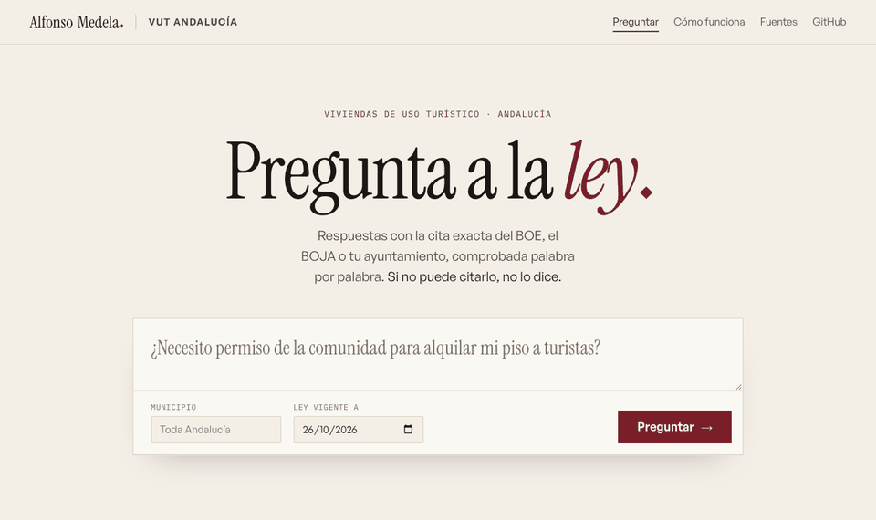
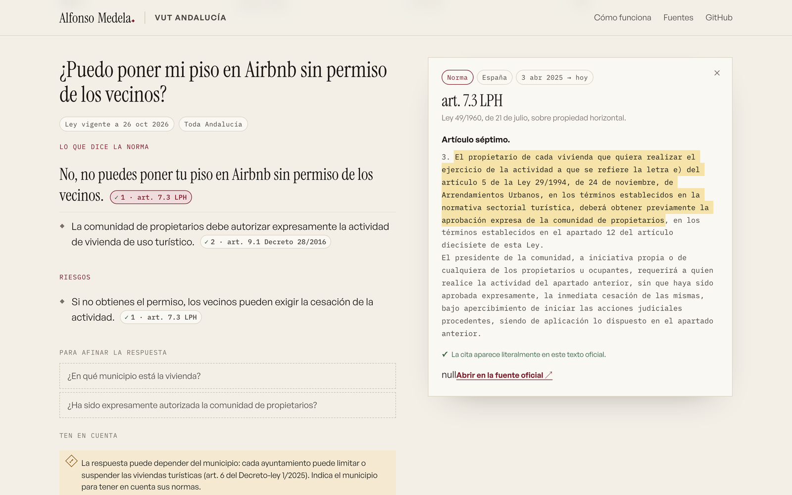
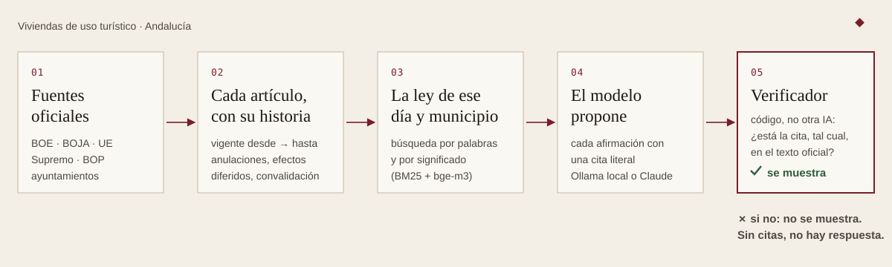
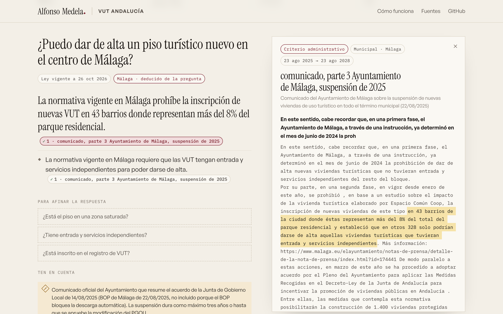

<div align="center">

# VUT Andalucía

### Pregunta a la ley.

**Todo sobre pisos turísticos en Andalucía, con la cita exacta del BOE, del BOJA o de tu ayuntamiento.<br>
Si no puede citarlo, no lo dice.**

[](https://github.com/alfonmedela/vut-andalucia/actions/workflows/ci.yml)


[English](README.en.md) · [Cómo funciona](#cómo-funciona) · [Qué cubre](#qué-cubre) · [Evaluación](#evaluación) · [Instalar](#instalar)



</div>

## Para quién

Para **propietarios, gestores, administradores de fincas y abogados** que necesitan saber qué dice
de verdad la norma, no lo que dice un foro. Escribes la pregunta como la harías a un compañero:

- *¿Puedo poner mi piso en Airbnb sin permiso de los vecinos?*
- *Si vendo el piso, ¿el comprador mantiene la inscripción en el Registro de Turismo?*
- *¿Puedo abrir una vivienda turística nueva en el centro de Málaga?*
- *¿Tengo que cobrar IVA si alquilo a turistas menos de 30 noches?*

Y recibes una respuesta ordenada (**lo que dice la norma · excepciones · qué hacer · riesgos**)
en la que cada frase lleva su cita. Al pulsarla ves el texto oficial con la frase resaltada,
la fecha desde la que está vigente y **cómo ha cambiado ese artículo a lo largo del tiempo**.

<p align="center">
  
</p>

## Qué lo hace distinto

| | |
|---|---|
| **Citas comprobadas, no inventadas** | El modelo propone cada afirmación con una cita literal. Un programa, no otra IA, comprueba que esa cita está tal cual en el texto oficial. Si no está, la frase no se muestra. Si no queda ninguna, el asistente lo dice en lugar de improvisar. |
| **La ley de cada día** | Cada artículo guarda todas sus versiones. Puedes preguntar por la ley vigente hoy o por la de junio de 2024. El art. 17.12 LPH, por ejemplo, existió desde diciembre de 2018, desapareció en enero de 2019 al decaer un decreto-ley, volvió en marzo de 2019 y cambió el 3 de abril de 2025. |
| **Avisa de lo que no se ve** | Anulaciones del Tribunal Supremo (el Registro Único de 2026), reales decretos-leyes pendientes de convalidación (el RDL 29/2026), efectos diferidos (el IVA de las estancias cortas, que se aplica desde el 1 de diciembre de 2026 aunque el BOE lo fecha en octubre). Cada aviso aparece junto a la cita afectada. |
| **Tu municipio** | Detecta el municipio en la pregunta (o lo eliges entre los 785 de Andalucía) y suma sus normas. Si la respuesta depende del municipio y no lo has dicho, te lo pregunta. Si el corpus no tiene normas de tu municipio, lo dice: que no estén no significa que no existan. |
| **Norma, sentencia o criterio** | Distingue lo que obliga (leyes, decretos, ordenanzas), lo que lo interpreta (sentencias) y lo que solo orienta (las preguntas frecuentes de la Junta o una instrucción municipal). |
| **Privado y gratis** | Funciona entero en tu ordenador con Ollama, sin enviar tus preguntas a nadie. Opcionalmente, con Claude para respuestas de mayor calidad. |
| **Sabe cuándo callar** | Antes de llamar al modelo, una barrera de código detecta preguntas sobre otra comunidad autónoma, sobre normas de un municipio que no está en el corpus o que intentan darle instrucciones. Después, una segunda revisión comprueba que cada cita pruebe de verdad lo que se afirma. |

## Cómo funciona

<p align="center"></p>

1. **Fuentes oficiales.** Se descargan de la API del BOE (incluidas las leyes andaluzas que consolida), del portal de textos consolidados de la Junta (BOJA), de la Oficina de Publicaciones de la UE y de los boletines provinciales. Cada texto queda registrado con su huella sha256.
2. **Cada artículo, con su historia.** Un parser reconstruye las versiones de cada apartado y sus fechas de vigencia, y conserva las notas oficiales que importan: «téngase en cuenta que se anula…», «con efectos de 1 de diciembre de 2026…».
3. **La ley de ese día y municipio.** La búsqueda combina palabras (BM25 en español, con un glosario que traduce «Airbnb» o «licencia» al lenguaje legal) y significado (embeddings multilingües bge-m3), solo entre lo vigente en la fecha y en el municipio.
4. **El modelo propone.** Un LLM (qwen3 en local o Claude) redacta afirmaciones breves, cada una con su fuente y una cita literal, y lista los datos que faltan para afinar la respuesta.
5. **El verificador decide.** Código determinista comprueba cada cita: palabras completas, sin puntos suspensivos que salten un «no». Lo que no pasa, no se muestra.

<p align="center"></p>

## Qué cubre

**40 fuentes oficiales, 2.245 fragmentos con su historia**, a 26 de octubre de 2026.

| Ámbito | Normas |
|---|---|
| **Andalucía** | Ley 13/2011 del Turismo · **Decreto 28/2016** de viviendas de uso turístico (4 versiones) · Decreto 143/2014 del Registro de Turismo · Decreto 194/2010 de apartamentos turísticos · **Decreto 20/2002 de turismo rural** · Decreto 82/2022 de hojas de reclamaciones · Decreto 144/2003 de la Inspección · Decreto-ley 1/2025 · Ley 5/2025 de Vivienda · LISTA · tipos del ITP · preguntas frecuentes de la Junta |
| **Municipios** | **Málaga** (DA 3.ª del PGOU, suspensión de 2025, modificación n.º 28, Instrucción 1/2024) · **Sevilla** · **Granada** · **Cádiz** (2022, MP 9 y MP 10) · **El Puerto de Santa María** · **Chiclana** · **Jerez** |
| **España** | LPH · LAU · RD 1312/2024 (Registro Único) y las **tres sentencias del Supremo de 2026** que lo anulan en parte · RD 933/2021 (registro de viajeros) · LO 4/2015 · **IVA** · IRPF · modelo 179 · IBI y plusvalía · ITP |
| **Unión Europea** | Reglamento (UE) 2024/1028 de alquileres de corta duración |

Detalle, motivo de cada fuente y fechas en [`fuentes.yaml`](src/vut_andalucia/data/fuentes.yaml) y en el [manifiesto](src/vut_andalucia/data/corpus/manifest.json).

## Evaluación

Las preguntas del conjunto de evaluación son **reales**: salen de un grupo de propietarios
asesorado por un abogado especialista y de foros y preguntas frecuentes públicas, anonimizadas.
Cada una lleva su fuente correcta y una **cita de referencia que un test comprueba literal** en la
versión vigente en su fecha. Si la ley cambia, el CI falla.

**105 casos**: 93 dentro de ámbito (33 normales, 21 casos límite, 15 premisas falsas, 15 por fecha,
9 municipales) y 12 fuera de ámbito (otras comunidades, municipios sin normas en el corpus,
cultura general y dos intentos de dar instrucciones al asistente).

### Respuestas (29/10/2026)

| | qwen3:8b en local | Claude Opus |
|---|---|---|
| **Correctas dentro de ámbito**, según un juez que compara con la nota del jurista | — | **83 %** |
| Correctas según el corrector automático (fuente correcta + hechos clave literales) | 28 % | 75 % |
| Se abstiene cuando la pregunta queda fuera del corpus | 31 % | **100 %** |
| Citas mostradas que no están literalmente en el texto oficial | **0** | **0** ¹ |
| Afirmaciones descartadas por la revisión de significado ² | — | 2 de 792 |
| Tiempo por respuesta | ~80 s | ~40 s |

Por tipo de pregunta, con Claude y según el juez: normales 30/33, premisas falsas 14/15, casos
límite 16/21, por fecha 10/15, municipales 7/9 y fuera de ámbito 12/12. Las preguntas por fecha
(«¿qué se exigía en 2017?») son hoy el punto más débil.

¹ Una cita difiere solo en una comilla tipográfica (`"` frente a `”`), que el propio texto oficial
mezcla; ninguna palabra cambia.

² La revisión ya no borra una afirmación por un matiz: si la cita prueba lo esencial, la
reescribe ciñéndola a la cita (que no cambia). Antes descartaba 75 y a veces se llevaba la regla
principal de la respuesta.

El corrector automático es deliberadamente estricto (exige palabras concretas) y no admite
paráfrasis; el juez es otro modelo y puede equivocarse. Por eso se publican los dos y el informe
completo, caso a caso: [`eval/resultados/f4-claude-opus.json`](eval/resultados/f4-claude-opus.json).

### Búsqueda

| Recuperación (híbrida, 26/10/2026) | 10 fragmentos (modelo local) | 25 fragmentos (Claude) |
|---|---|---|
| La fuente correcta llega al modelo | 81 % | 90 % |
| La frase exacta de referencia llega al modelo | 66 % | 77 % |

Medir con preguntas reales en lugar de preguntas hechas a medida baja las cifras, y está bien que
así sea: con el conjunto anterior, de 12 preguntas redactadas junto al sistema, la recuperación
daba un 100 %. Lo que falla está listado caso a caso en el informe JSON, y la [hoja de ruta](#hoja-de-ruta)
dice cómo atacarlo.

## Instalar

**Para usarlo en tu ordenador** (Mac, Windows o Linux), sin saber programar:

1. Instala [Ollama](https://ollama.com) y [uv](https://docs.astral.sh/uv/).
2. En una terminal, copia y pega:

```bash
ollama pull qwen3:8b && ollama pull bge-m3
git clone https://github.com/alfonmedela/vut-andalucia && cd vut-andalucia
uv run vut web
```

3. Abre <http://127.0.0.1:8000> en el navegador.

**Con Claude** (respuestas más finas). Con tu suscripción de Claude, si tienes Claude Code
instalado y la sesión iniciada, sin clave de API y solo para uso personal:

```bash
uv run vut web --proveedor suscripcion
```

O con una clave de la API de Anthropic, que es lo que usa la demo pública:

```bash
uv sync --extra claude
ANTHROPIC_API_KEY=... uv run vut web --proveedor claude
```

**Desde la terminal:**

```bash
uv run vut preguntar "¿Qué mayoría hace falta para prohibir pisos turísticos?"
uv run vut preguntar "¿Puedo abrir una VUT nueva?" --municipio Cádiz
uv run vut preguntar "¿Qué mayoría hacía falta?" --fecha 2024-06-01
uv run vut buscar "multa por no registrar viajeros"     # solo búsqueda, sin modelo
```

## Para desarrolladores

- **Añadir una norma o un municipio** es editar [`fuentes.yaml`](src/vut_andalucia/data/fuentes.yaml): id oficial, de dónde se descarga, municipio y por qué está. `uv run vut sync` lo descarga, lo trocea y falla si algo no cuadra; `uv run vut embed` actualiza los vectores.
- **Por qué no hay base de datos vectorial.** Son unos miles de fragmentos: un índice en memoria se construye en milisegundos y tiene menos piezas que puedan fallar.
- **Tres capas, de la más fiable a la menos.** 1) Una barrera de código decide antes del modelo si la pregunta cae fuera del corpus. 2) Un verificador de código exige que cada cita esté literalmente en el texto oficial: es binario y auditable, y es lo único que se garantiza al 100 %. 3) Una segunda llamada al modelo revisa que cada cita pruebe lo que se afirma y descarta lo que no; si esa revisión falla, la respuesta se marca como no revisada. La cita se muestra siempre al lado, para que el lector juzgue.
- **Lo que se probó y no compensó:** un reranker local (bge-reranker-v2-m3) subía la frase correcta en el contexto del 63 % al 66 % a cambio de 11 s más por pregunta. Dar más contexto a Claude (25 fragmentos en vez de 10) la sube al 77 % sin coste de búsqueda.
- **Calidad:** ruff, mypy estricto, 249 tests y la evaluación de recuperación corren en cada commit. Las revisiones de código, de fallos silenciosos, de seguridad y del pipeline RAG de esta fase están resueltas en el historial.
- **Demo pública:** [`space/`](space) contiene el Dockerfile para Hugging Face Spaces, con límites por IP y diarios, y modo solo búsqueda si no hay clave.

## Límites

- **No es asesoramiento jurídico.** Explica qué dice la norma; no qué te conviene hacer en tu caso.
- **Municipios:** hay normas de 7 municipios. En el resto, el asistente avisa de que no las tiene. Faltan, por ejemplo, Córdoba (su edicto exige un código de verificación) y Manilva (el BOP de Málaga bloquea la descarga automática). Sevilla solo está por la instrucción de su Gerencia, porque su limitación por barrios se publicó como PDF escaneado.
- **Fiscalidad:** cubre el IVA, el IRPF, el modelo 179, el ITP, el IBI y la plusvalía en lo que afecta a las VUT, no la fiscalidad general.
- **Fechas:** cuando el BOE o un boletín no publican la fecha de efectos de una versión, se usa la de publicación y la respuesta lo advierte.
- **Modelos locales pequeños:** con qwen3:8b solo el 28 % de las respuestas es correcto y completo. Sus citas son reales, pero a menudo interpreta mal o incompleto: úsalo para buscar, y Claude para responder.
- **Preguntas por fecha:** con Claude acierta 9 de 15. Razonar sobre qué redacción estaba vigente en una fecha pasada sigue siendo lo más difícil.

## Hoja de ruta

- [x] Corpus versionado del BOE, el BOJA, la UE y los municipios, con avisos de vigencia
- [x] Búsqueda híbrida por fecha y municipio, y respuesta con citas verificadas
- [x] Interfaz web con panel de cita e historia de cada precepto
- [x] Evaluación con preguntas reales
- [x] Barrera de ámbito, revisión de significado y juez en la evaluación
- [ ] Reescritura de consultas largas en subpreguntas jurídicas
- [ ] Revisión del conjunto de evaluación por un abogado
- [ ] Remisiones entre artículos («letra e) del artículo 5 de la Ley 29/1994»)
- [ ] Más municipios: Córdoba, Marbella, Estepona, Manilva y los que se sumen
- [ ] Servidor MCP para usarlo desde Claude Desktop o Claude Code
- [ ] Vigía semanal de cambios en el BOE y el BOJA

## Licencia

Código bajo licencia [MIT](LICENSE). Los textos legales proceden del BOE, el BOJA, la Oficina
de Publicaciones de la UE y los boletines provinciales, y se reutilizan citando la fuente.

---

<p align="center">
Hecho por <a href="https://alfonsomedela.com"><b>Alfonso Medela</b></a>, físico y desarrollador de IA.<br>
Antes, Chief AI Officer de un producto sanitario con marcado CE: allí aprendí que una IA que acierta casi siempre no basta. Tiene que poder demostrarlo.
</p>
